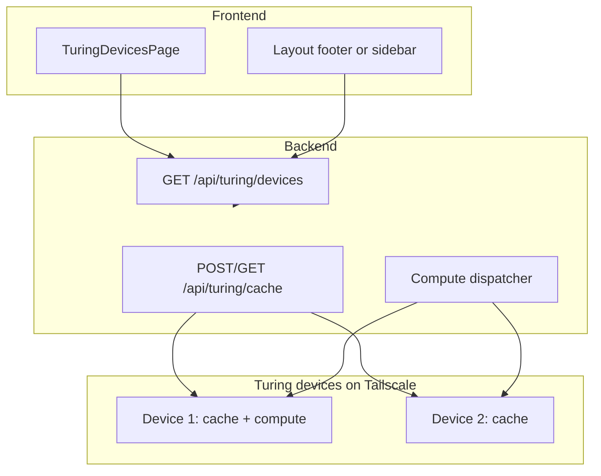

# Turing Pool: Cache (A), Compute (B), and In-App Device Health Monitor

## Scope

- **A.** Use RAM on Turing devices for **in-memory cache / data staging** (backend can store/retrieve cache entries on remote devices).
- **B.** Use Turing devices for **compute** (e.g. inference, batch jobs); backend dispatches work and collects results.
- **In-app monitor:** A dedicated UI that shows **health of all connected Turing devices** (status, last seen, RAM, capabilities).

---

## 1. Backend: Turing pool module and APIs

**Location:** New module under backend, e.g. [backend/turing/](backend/turing/) or [backend/lib/turing-pool.ts](backend/lib/turing-pool.ts) plus routes in [backend/server.ts](backend/server.ts).

**Discovery and lifecycle (existing plan, now implemented):**

- **Register:** `POST /api/turing/register` — body: `{ hostname, tailscale_ip, ram_mb?, capabilities?: string[] }`. Store in memory or DB (`turing_devices`: id, hostname, ip, ram_mb, capabilities, last_seen, status).
- **Heartbeat:** `POST /api/turing/heartbeat` — device sends `{ device_id }` or identifies by IP; backend updates `last_seen`, optionally `ram_used_mb`, `load`.
- **List devices:** `GET /api/turing/devices` — returns all registered devices with health (status: healthy/stale/offline from last_seen threshold). Optionally `GET /api/ops/turing/devices` with `requireRole("operator")` for same payload.
- **Config:** `TURING_POOL_ENABLED`, `TURING_HEARTBEAT_STALE_MIN`, `TURING_DEVICE_PORT`.

**A. In-memory cache / data staging:**

- **Device contract:** A Turing device may expose a small HTTP API (e.g. on `TURING_DEVICE_PORT`):
  - `PUT /cache/:key` — store blob (body), optional TTL.
  - `GET /cache/:key` — retrieve blob; 404 if missing or expired.
  - `DELETE /cache/:key` — evict.
- **Backend role:** Backend selects a device (e.g. by least RAM used or round-robin), then **proxies** cache requests to that device’s Tailscale IP (or backend calls device agent). Alternatively, devices push “I have capacity” and backend stores a mapping key → device_id and proxies to that device.
- **API surface for app/other services:** e.g. `POST /api/turing/cache` with `{ key, value, ttl_sec?, preferred_device_id? }` and `GET /api/turing/cache/:key` — backend routes to the appropriate Turing device and returns the result. Implement in [backend/server.ts](backend/server.ts) or [backend/turing/](backend/turing/) and call device endpoints over Tailscale.

**B. Compute (inference / batch jobs):**

- **Device contract:** A Turing device exposes, e.g.:
  - `POST /compute/job` — body: `{ job_id, type: "inference"|"batch", payload }`. Device runs the job, returns `{ job_id, status, result? }` or streams result.
  - `GET /compute/job/:job_id` — status and result.
- **Backend role:** Backend receives a request to run compute (e.g. from existing inference or batch endpoints), selects a Turing device (by capability and load), dispatches via `POST /compute/job` to the device’s Tailscale URL, and returns or streams the result to the client. Implement in backend (e.g. `backend/turing/compute-dispatcher.ts`) and wire into existing inference/batch entrypoints if desired.
- **Capabilities:** Use `capabilities` from registration (e.g. `["inference", "cache"]`) so backend only sends inference to devices that advertise it.

**Health for monitor:** The `GET /api/turing/devices` response must include, per device: `id`, `hostname`, `tailscale_ip`, `status` (healthy/stale/offline), `last_seen` (ISO timestamp), `ram_mb`, `ram_used_mb` (if reported), `capabilities`, optional `load` or `current_jobs`. This is what the frontend monitor will display.

---

## 2. In-app device health monitor

**Placement:** A dedicated **Turing devices** page in the main app, plus an optional compact summary in the shell.

**New route:** Add a route, e.g. `/turing` or `/devices`, in [src/app/routes.tsx](src/app/routes.tsx), and add a nav entry in [src/app/Layout.tsx](src/app/Layout.tsx) (e.g. “Turing” or “Devices” with a Server/Network icon).

**New page component:** e.g. [src/pages/TuringDevicesPage.tsx](src/pages/TuringDevicesPage.tsx).

**Behavior:**

- **Data:** Call `GET /api/turing/devices` (or `GET /api/ops/turing/devices` when operator) on mount and on a polling interval (e.g. 10–30 s). Use existing patterns: `fetch` + state or a small hook, or TanStack Query like [src/pages/CommandPage.tsx](src/pages/CommandPage.tsx) / [src/hooks/useMissionSnapshot.ts](src/hooks/useMissionSnapshot.ts).
- **UI:** Display a **monitor** of connected devices:
  - **Summary line:** e.g. “3 devices connected, 2 healthy, 1 stale.”
  - **Table or card list** with columns/cards: Hostname, Tailscale IP, Status (healthy/stale/offline with visual indicator), Last seen, RAM (total and used if reported), Capabilities. Optional: “Current jobs” or “Load” if backend exposes them.
  - **Empty state:** “No Turing devices registered. Connect devices on the Tailscale VPN and register them.”
- **Access control:** Show page to all authenticated users, or restrict to operator/admin (reuse [src/lib/api/auth.ts](src/lib/api/auth.ts) and session from mission snapshot). If using ops endpoint, require operator role.
- **Styling:** Match existing mission shell: [src/app/Layout.tsx](src/app/Layout.tsx) and card/table patterns from [src/pages/CommandPage.tsx](src/pages/CommandPage.tsx) (Cards, Badges, tables). For NASA analogue alignment, use flat panels and monospace/technical typography.

**Optional shell summary:** In [src/app/Layout.tsx](src/app/Layout.tsx) footer or sidebar, add a line like “Turing: N devices (M healthy)” with a link to `/turing`. Fetch device count from the same API (or a lightweight `GET /api/turing/devices/summary` returning `{ total, healthy, stale }`) to avoid loading the full list in the shell.

**Contract:** Define a minimal TypeScript type or Zod schema for the device list response (e.g. in [src/lib/contracts/](src/lib/contracts/) or next to the hook) so the frontend is typed.

---

## 3. Data flow (high level)

---

## 4. Implementation order

1. **Backend: Turing pool core** — Register, heartbeat, in-memory store of devices, `GET /api/turing/devices` with health (status, last_seen, ram_mb, capabilities). Env flags and docs.
2. **Frontend: Device health monitor** — New route and page, fetch devices, show table/cards with health; optional shell summary.
3. **Backend: Cache (A)** — Device contract (PUT/GET/DELETE /cache/:key), backend proxy endpoints and device selection; document in [docs/TURING_TAILNET_DEVICES.md](docs/TURING_TAILNET_DEVICES.md) or similar.
4. **Backend: Compute (B)** — Device contract (POST /compute/job, GET /compute/job/:id), dispatcher in backend, optional wiring to existing inference/batch APIs; document.
5. **Docs** — Update [docs/NETWORK_CONNECTIVITY_STRATEGY.md](docs/NETWORK_CONNECTIVITY_STRATEGY.md) or add Turing doc with: how to join devices to the tailnet, register/heartbeat, cache and compute contracts, and that the app shows device health under `/turing`.

---

## 5. Files to add or change

| Area                | File(s)                                                                                                                                                                                      |
| ------------------- | -------------------------------------------------------------------------------------------------------------------------------------------------------------------------------------------- |
| Backend Turing pool | New: `backend/turing/` or `backend/lib/turing-pool.ts`; [backend/server.ts](backend/server.ts) — register, heartbeat, GET devices, cache proxy, compute dispatcher routes.                   |
| API contract        | New: e.g. `src/lib/contracts/turing.ts` — Zod schema for device list and optional cache/compute request/response.                                                                            |
| Frontend monitor    | New: [src/pages/TuringDevicesPage.tsx](src/pages/TuringDevicesPage.tsx). Update [src/app/routes.tsx](src/app/routes.tsx), [src/app/Layout.tsx](src/app/Layout.tsx) (nav + optional summary). |
| Docs                | New or update: [docs/TURING_TAILNET_DEVICES.md](docs/TURING_TAILNET_DEVICES.md), [docs/NETWORK_CONNECTIVITY_STRATEGY.md](docs/NETWORK_CONNECTIVITY_STRATEGY.md).                             |

---

## 6. Out of scope for this plan

- Actual device-side agent implementation (the “old hardware” you’ll hook up): only the **contract** (HTTP endpoints and payloads) is specified; you can implement the agent in any language.
- Tailscale API integration for auto-discovery: optional later; for now devices self-register via `POST /api/turing/register`.
- Auth for device–backend communication (e.g. mTLS or Tailscale auth): can be added when hardening the device API.

