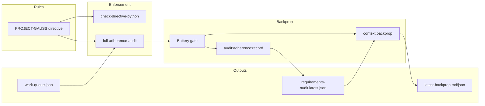
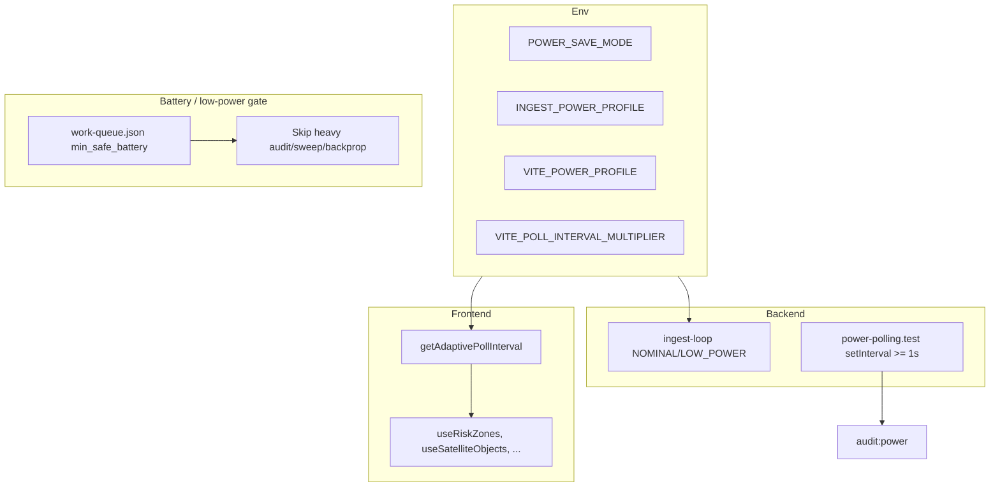

# Space Weather Monitor - System Architecture

## Overview

A lightweight, real-time 3D visualization of Earth's magnetosphere and Van Allen radiation belts, driven by live space weather data from NOAA SWPC, NASA DSCOVR, ESA HAPI, JAXA ERG, and MMS. The **backend** is a full Express API server that runs an **ingestion worker** (same process), serves all HTTP/WebSocket API routes, and optionally integrates with the Rust orchestrator, Turing pool (Tailscale), and ML/nowcast. See [ARCHITECTURE_REFINEMENTS.md](ARCHITECTURE_REFINEMENTS.md) for doc-vs-reality alignment.

---

## System Architecture Diagram

```
┌─────────────────────────────────────────────────────────────────────────────┐
│                           EXTERNAL DATA SOURCES                              │
├─────────────┬─────────────┬─────────────┬─────────────┬─────────────────────┤
│  NOAA SWPC  │ NASA DSCOVR │  ESA HAPI   │  JAXA ERG   │  MMS CDAWeb / LASP   │
│ (Kp, alerts)│(solar wind)│ (particles) │  (ERG)      │  (reconnection, etc.) │
└──────┬──────┴──────┬──────┴──────┬──────┴──────┬──────┴──────────┬────────────┘
         │                 │                 │                    │
         └─────────────────┴─────────────────┴────────────────────┘
                                    │
                                    ▼
┌─────────────────────────────────────────────────────────────────────────────┐
│                        BACKEND (Express API server)                             │
│  ┌───────────────────────────────────────────────────────────────────────┐   │
│  │  INGESTION WORKER (same process)                                        │   │
│  │  Adapters → Validator/Normalizer → state.ts + Supabase                  │   │
│  │  Canonical feed, MMS reconnection, aurora map, source status           │   │
│  └───────────────────────────────────────────────────────────────────────┘   │
│  ┌─────────────┐  ┌─────────────┐  ┌─────────────────────────────────────┐   │
│  │ HTTP API    │  │ WebSocket   │  │ Optional: Turing pool, ML client,    │   │
│  │ (auth, feed,│  │ (auth)      │  │ probability gate, orchestrator       │   │
│  │  ops, ingest)│  │             │  │                                      │   │
│  └─────────────┘  └─────────────┘  └─────────────────────────────────────┘   │
│  ┌───────────────────────────────────────────────────────────────────────┐   │
│  │ CyberTiger (rate limit, blocklist, audit) · RBAC (viewer/operator/admin)│   │
│  └───────────────────────────────────────────────────────────────────────┘   │
└─────────────────────────────────────────────────────────────┬───────────────┘
                                                              │
                                                              │ HTTPS + CORS
                                                              ▼
┌─────────────────────────────────────────────────────────────────────────────┐
│                            FRONTEND APPLICATION                              │
│  ┌───────────────────────────────────────────────────────────────────────┐  │
│  │  Data state (fetcher, interpolation, derived params)                   │  │
│  └───────────────────────────────────────────────────────────────────────┘  │
│  ┌───────────────┐   ┌───────────────┐   ┌───────────────┐                  │
│  │  3D Renderer  │   │    UI Layer   │   │  Performance  │                  │
│  │  (Three.js)   │   │    (React)    │   │   Monitor     │                  │
│  └───────────────┘   └───────────────┘   └───────────────┘                  │
│  Shader modules: Earth, Van Allen belts (SDF), Magnetosphere (Shue), etc.    │
└─────────────────────────────────────────────────────────────────────────────┘
```

---

## Component Breakdown

### Backend (Express API server)

| Component | Responsibility |
|-----------|----------------|
| `backend/server.ts` | Main Express app: CORS, security headers, auth middleware, route mounting |
| `worker/ingest-loop.ts` | Ingestion worker: parallel fetch from NOAA, ESA, JAXA, MMS adapters; validator/normalizer; writes canonical feed, MMS reconnection, aurora map, source status to `state.ts` (and Supabase) |
| Adapters | `noaa-swpc.ts`, `esa-hapi.ts`, `jaxa-erg.ts`, `mms-cdaweb.ts`, `mms-lasp.ts` — fetch and normalize external data |
| CyberTiger (`cybertiger/daemon.ts`) | Rate limiting, blocklist, audit trail, admin block/unblock |
| Auth / RBAC (`auth.ts`) | Token auth, roles (viewer, operator, admin), clearance checks |
| Contracts | `mission-core-contract.ts`, `heliophysics-contract.ts`, `packet-ingest-contract.ts` — assert API shape at startup/key requests |

### Key API routes

| Route / prefix | Description |
|----------------|-------------|
| `GET /health` | Liveness; no auth |
| `GET /api/auth/session` | Current session (auth optional per config) |
| `GET /api/feed/space-weather/5s`, `.../latest` | Canonical space weather feed |
| `GET /api/feed/mms/reconnection`, `.../latest` | MMS reconnection vectors |
| `GET /api/feed/aurora/map` | Aurora grid (HEALPix) |
| `GET /api/feed/sources/status` | Per-source health |
| `GET /api/feed/threats/latest`, `.../dashboard/latest` | Threats and dashboard payload |
| `GET /api/ops/command/latest` | Latest mission command intent |
| `GET /api/ops/network/audit` | Network audit (operator) |
| `GET /api/mission/core/latest` | Mission core snapshot |
| `POST /api/turing/register`, `.../heartbeat` | Turing pool device registration |
| `GET /api/turing/devices`, `.../summary` | Turing devices list/summary |
| `POST/GET/DELETE /api/turing/cache` | Turing cache proxy |
| `POST /api/turing/compute`, `GET .../job/:deviceId/:jobId` | Compute dispatch (operator) |
| `GET /api/security/cybertiger/status` | CyberTiger status (operator) |
| `GET /api/security/cybertiger/events` | Audit events (admin) |
| `POST /api/security/cybertiger/block`, `.../unblock` | Block/unblock IP (admin) |
| `POST /api/feedback`, `GET .../latest` | User feedback (viewer submit, operator list) |
| `POST /api/ingest/telemetry/packets` | Telemetry packet ingest (admin); CCSDS/XTCE path: see [CCSDS_XTCE_ORCHESTRATOR.md](CCSDS_XTCE_ORCHESTRATOR.md) |
| `POST /api/ai/nowcast/infer`, `.../train` | ML nowcast inference (operator) / training trigger (admin) |
| `POST /api/ai/surya/forecast`, `.../flare` | Surya heliophysics model (stub 501; see [SURYA_INTEGRATION.md](SURYA_INTEGRATION.md)) |

Other endpoints (e.g. chat) may be mounted elsewhere; see `backend/server.ts` for the full list.

**Packet telemetry (CCSDS/XTCE):** The production path for CCSDS decode and XTCE-backed canonical mapping is the Rust orchestrator; it posts to `POST /api/ingest/telemetry/packets`. See [CCSDS_XTCE_ORCHESTRATOR.md](CCSDS_XTCE_ORCHESTRATOR.md).

### Frontend

| Component | Responsibility |
|-----------|----------------|
| `useSpaceWeather` | Data fetching, interpolation, derived params |
| `SpaceScene` | Three.js canvas setup, camera, lighting |
| `Earth` | Earth mesh with atmosphere shader |
| `VanAllenBelts` | Instanced particles with SDF glow |
| `Magnetosphere` | Parametric Shue model surface |
| `HUD` | Live data display with stale indicators |
| `LayerToggles` | Visibility controls for each layer |

---

## Data Models

### Backend output (canonical space weather)

The schema below describes the **canonical space-weather** payload used by feed endpoints (e.g. `/api/feed/space-weather/latest`). Other API routes (mission core, Turing, CyberTiger, ingest, AI, etc.) have their own request/response shapes; see `backend/server.ts` and `backend/types.ts`.

```typescript
interface SpaceWeatherResponse {
  timestamp: string;          // ISO 8601
  solarWind: {
    speed: number;            // km/s
    density: number;          // particles/cm³
    pressure: number;         // nPa
  };
  imf: {
    bz: number;               // nT (negative = southward)
    bt: number;               // nT total
  };
  particles: {
    protonFlux: number;       // pfu (>10 MeV)
    electronFlux: number;     // electrons/cm²/s/sr
  };
  indices: {
    kp: number;               // 0-9
    dst: number;              // nT
  };
  flags: {
    stale: boolean;
    source: 'live' | 'cache' | 'fallback';
    lastUpdate: string;
  };
}
```

### Frontend Derived State

```typescript
interface VisualizationState {
  magnetopauseCompression: number;  // 0.6-1.0 (1 = relaxed)
  beltIntensity: number;            // 0-1
  reconnectionStrength: number;     // 0-1 (southward Bz)
  stormLevel: number;               // 0-1 (Kp normalized)
}
```

---

## Sequence Diagram: Data Refresh Cycle

```
┌──────────┐     ┌──────────────┐     ┌────────────┐     ┌──────────┐
│ Frontend │     │ Backend API  │     │  NOAA API  │     │ NASA API │
└────┬─────┘     └──────┬───────┘     └─────┬──────┘     └────┬─────┘
     │                  │                   │                 │
     │  GET /api/feed/space-weather/*       │                 │
     │─────────────────>│                   │                 │
     │                  │  (Ingestion worker maintains        │
     │                  │   canonical state; API serves it)   │
     │                  │                   │                 │
     │<─────────────────│                   │                 │
     │  JSON Response   │                   │                 │
     │                  │                   │                 │
     │  Interpolation (EMA), update 3D scene (60fps)         │
```

---

## Fail-Soft Pathways

### Stale Data Handling

1. **Cache Hit (fresh)**: Return cached data immediately
2. **Cache Hit (stale)**: Return stale data with `flags.stale = true`
3. **API Failure**: Return cached data or fallback values
4. **Complete Failure**: Frontend uses rolling average decay

### Frontend Decay Logic

```typescript
// When data is stale, gradually decay toward baseline
const decayFactor = Math.exp(-timeSinceUpdate / DECAY_HALF_LIFE);
const decayedValue = baseline + (lastValue - baseline) * decayFactor;
```

---

## Security architecture

- **Transport**: HTTPS in production; CORS restricted to allowed origins (see `ALLOWED_ORIGINS`).
- **Headers**: `X-Content-Type-Options`, `X-Frame-Options`, `Referrer-Policy`, `Permissions-Policy`.
- **RBAC**: Roles `viewer`, `operator`, `admin` via Supabase auth metadata; clearance levels (e.g. `mission`, `restricted`) for sensitive endpoints.
- **CyberTiger**: Rate limiting, automatic temporary IP blocking, blocklist, audit events. Admin-only block/unblock and event listing.
- **Input**: Schema validation (Zod) on external data and key request bodies; packet ingest and contracts asserted at startup.

For control mapping and NIST/ISO alignment, see [CYBERTIGER_COMPLIANCE_BASELINE.md](CYBERTIGER_COMPLIANCE_BASELINE.md). Release security gates: [RELEASE_CHECKLIST.md](RELEASE_CHECKLIST.md).

| Layer | Protection |
|-------|------------|
| Transport | HTTPS only (production) |
| CORS | Strict origin whitelist (`ALLOWED_ORIGINS`) |
| Input | Schema validation on external data and ingest payloads |
| Rate limit | Configurable per IP (CyberTiger) |
| Secrets | Environment variables / Supabase secrets; not in code |

---

## Rules and enforcement

Project Gauss rules (memory, power, audit/security, UI) are defined in **`.cursor/rules/PROJECT-GAUSS-STRICT-OPTIMIZATION-DIRECTIVE.mdc`**. Enforcement and backprop flow as follows.

**Enforcement**

1. **Python (directive):** `backend/scripts/check-directive-python.py` — GC, lazy load, MLX cache limits; run via `npm run check:directive`.
2. **Runtime audit:** `backend/scripts/full-adherence-audit.ts` — RBAC, lint, tests, build, directive, backend-env, security, RLS, network. **Battery-aware:** below `min_safe_battery_percent` (from `reports/orchestrator/work-queue.json`, default 25) only light checks run (RBAC preflight, lint, directive, backend-env). Use `--no-battery-check` to force full audit (CI or plugged-in).
3. **Test sweep:** `backend/scripts/orchestrate-tests.ts` — skips heavy UI (e.g. Playwright) when battery &lt; min.

**Backprop**

- **`npm run backprop:full`** — Battery check → if OK: full audit then `context:backprop`; if low: `context:backprop` only. Capsule and backprop actions come from the progress checker using `requirements-audit.latest.json` and milestones. See [BACKPROP_RUNBOOK.md](BACKPROP_RUNBOOK.md).

**Work queue**

- Rust orchestrator and audit automation produce/consume **`reports/orchestrator/work-queue.json`** with `min_safe_battery_percent`. Used by the test sweep and by the full-adherence-audit for battery gating.



---

## Power optimisation architecture

Power optimisation is cross-cutting: backend cadences, frontend polling, battery gating for heavy work, and env-driven profiles. The goal is to respect the 8GB M1 / 6GB Apollo constraint and avoid spin loops and high-frequency polling.

**Constraint (from directive):** No spin loops; no high-frequency polling (backend `setInterval` ≥ 1000 ms); probability gating so the LLM stays dormant until 3-sigma; MLX/GPU only when needed.

**Layers**

| Layer | Mechanism | Key files / env |
|-------|-----------|------------------|
| Backend ingest | `NOMINAL_CADENCE` vs `LOW_POWER_CADENCE`; `INGEST_POWER_PROFILE=low-power` / `POWER_SAVE_MODE=true` | `backend/worker/ingest-loop.ts`, `.env` |
| Backend cadence enforcement | All `setInterval` in backend ≥ 1000 ms (test) | `backend/power-polling.test.ts`, `backend/scripts/power-drain-audit.ts` |
| Frontend polling | Adaptive interval from profile + battery + visibility | `src/lib/power/polling.ts` (`getAdaptivePollInterval`), hooks (e.g. `useRiskZones`, `useSatelliteObjects`) |
| Battery gate | Skip heavy audit/sweep/backprop when battery &lt; `min_safe_battery_percent` | `reports/orchestrator/work-queue.json`, `battery-and-work-queue.ts`, `full-adherence-audit.ts`, `orchestrate-tests.ts`, `backprop-with-audit.ts` |
| Sweep power-saver | Skip Backend/AI granular, Full-stack mission, Playwright when low battery or low-power profile | `backend/scripts/orchestrate-tests.ts` |

**Single entry for battery-safe dev:** `npm run dev:battery` sets low-power env so frontend and backend use longer intervals and the 3D scene throttles. See [BATTERY_AND_TELEGRAM.md](BATTERY_AND_TELEGRAM.md) and [POWER_DRAIN_AUDIT.md](POWER_DRAIN_AUDIT.md).



**Power consumption and mitigation**

| Component | Power draw | Mitigation |
|-----------|------------|------------|
| Ingest worker | Periodic HTTP + CPU | `INGEST_POWER_PROFILE=low-power` → longer cadence; `POWER_SAVE_MODE=true` |
| Frontend polling / 3D | Timers + GPU | `VITE_POWER_PROFILE=low-power`, `getAdaptivePollInterval`, back off when tab hidden or saveData |
| Orchestrator (Rust) | Event-driven + sleep | No spin loops; configurable audit interval (e.g. 30 min) |
| MLX / DeepSeek | GPU | Run only when needed; stub for lightweight testing; prefer plugged-in for long sessions |
| Audit / sweep / backprop | CPU-heavy | Battery gate: skip or light-run when battery &lt; min_safe; power-saver sweep skips granular/fullstack/Playwright |

---

## Performance Targets

| Metric | Target |
|--------|--------|
| Initial Load | < 2 seconds |
| Data Refresh Size | < 200KB |
| Frame Time | < 16.67ms (60fps) |
| Shader Time | < 8ms per frame |
| Backend Cold Start | < 1.5s |

---

## File structure

```
backend/
├── server.ts              # Express app, all API routes, ingestion worker start
├── auth.ts                # Auth middleware, RBAC, clearance
├── state.ts               # In-memory state (canonical, MMS, aurora, source status)
├── worker/
│   └── ingest-loop.ts     # Ingestion worker (adapters → state)
├── adapters/
│   ├── noaa-swpc.ts
│   ├── esa-hapi.ts
│   ├── jaxa-erg.ts
│   ├── mms-cdaweb.ts
│   └── mms-lasp.ts
├── cybertiger/
│   └── daemon.ts          # Rate limit, blocklist, audit
├── contracts/             # Mission-core, heliophysics, packet-ingest
├── ml-client/             # Nowcast inference, probability gate
└── turing/                # Pool, cache-proxy, compute-dispatcher

src/
├── components/
│   ├── scene/             # SpaceScene, Earth, VanAllenBelts, Magnetosphere
│   └── ui/                # HUD, LayerToggles, etc.
├── hooks/
│   └── useSpaceWeather.ts
├── lib/
└── pages/

supabase/
└── functions/
    └── spaceweather/      # Optional edge function (legacy/deployment)
        └── index.ts

docs/
├── ARCHITECTURE.md        # This file
├── ARCHITECTURE_REFINEMENTS.md
├── CYBERTIGER_COMPLIANCE_BASELINE.md
├── PROJECT_GAUSS_PLAIN_ENGLISH.md
├── SHADER_SPEC.md
└── QA_TEST_PLAN.md
```
