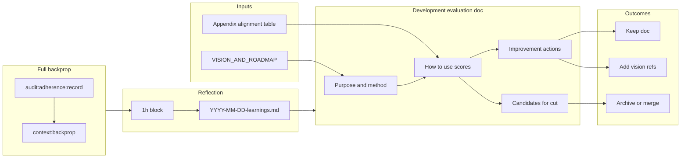

# Development Evaluation

This document helps the team learn from the current documentation set and improve. It explains how alignment to the product vision is scored, how to interpret scores, and what to do next—including which documents are candidates for cut (archive or merge).

---

## What we evaluate

Alignment is measured against the vision and roadmap in [VISION_AND_ROADMAP.md](VISION_AND_ROADMAP.md). The vision includes:

- **Ultimate operations tool** — Agentic AI (orchestrator, data analysis models), post-quantum secured cybersecurity.
- **Value chain** — SSA today → value from debris/data → blockchain-backed tokenisation (lawyer-ratified, SWF / Space Debris DAO / RAND) → servicing & manufacturing → asteroid mining → Ceres & Pallas.
- **Operator progression** — MEO/GEO → ISAM → Space Station → deep space; horizontally receptive.
- **Public platform** — Fun, mysterious, impactful; quests/missions; prepared for clearances and sensitive data.
- **Roadmap** — V0.1 now; this year = team, investment, first customers; by 2030 = in-space (datacenters); long-term = Ceres & Pallas.
- **Compliance** — NIST, ISO 27001, ECSS; geopolitically agnostic; grants and collaborations (EIC, ESA, UK, NASA, SWF, Space Debris DAO, RAND).

**Alignment** = how much each document supports or reflects this vision (e.g. operator tooling, debris, standards, roadmap, compliance). Scores are 0–100; 100 = most aligned.

The full scored list is in the **Appendix: Document alignment review** in [VISION_AND_ROADMAP.md](VISION_AND_ROADMAP.md).

### Step 8: Security Compliance Mapping

**Step 8 (Security Compliance Mapping)** is part of the full adherence audit ([AUDIT_STEPS.md](AUDIT_STEPS.md)). It produces a machine-readable control mapping (NIST/ISO/space) and feeds into the orchestrator audit summary and progress evaluation. The script `backend/scripts/security-compliance-check.ts` writes `reports/progress/security-compliance.latest.json`; the main audit embeds this as `security_compliance` in `reports/progress/requirements-audit.latest.json`. The orchestrator includes a security summary line in the Telegram audit cycle; the progress checker adds a note and, if any control fails, a missing requirement and score cap. See [CYBERTIGER_COMPLIANCE_BASELINE.md](CYBERTIGER_COMPLIANCE_BASELINE.md) for the control baseline.

---

## How to use the scores

| Score band | Interpretation | Action |
|------------|----------------|--------|
| **75+** | High alignment; core to vision or roadmap. | **Keep.** Optionally add a one-line “Vision” or “Roadmap” subsection so the link is explicit. |
| **50–74** | Mid alignment; useful but not vision-narrative. | **Keep and improve.** Consider adding a short vision/roadmap reference, or leave as-is if purely operational. |
| **30–49** | Low alignment; operational or one-time; may be redundant. | **Review.** See “Candidates for cut” below; keep if referenced or operational, archive/merge if redundant. |
| **&lt;30** | Component-level or superseded. | **Strong candidate for cut or merge.** |

Low vision alignment does not automatically mean “delete”—many low-scoring docs are still needed for workflow (e.g. RELEASE_CHECKLIST, WORKTREE_ARCHITECTURE). Use the recommendations in the next section to decide.

---

## How to improve

1. **Raise alignment of high-value docs** — In [COMPETITIVE_READINESS_SCORECARD.md](COMPETITIVE_READINESS_SCORECARD.md), [COMPETITIVE_WORKSTREAM_TICKETS_V1.md](COMPETITIVE_WORKSTREAM_TICKETS_V1.md), and [DEBRIS_RISK_3D.md](DEBRIS_RISK_3D.md), add a short “Vision” or “Roadmap” subsection (e.g. one sentence) that points to [VISION_AND_ROADMAP.md](VISION_AND_ROADMAP.md) and the 2025/2030/Ceres & Pallas narrative where relevant.
2. **Merge or archive low-scoring, redundant, or one-time docs** — Use the “Candidates for cut” table below; perform archive/merge in a follow-up change after approval.
3. **Re-score after changes** — When you add vision refs or archive docs, update the Appendix in VISION_AND_ROADMAP.md so the list stays accurate.

---

## Post-backprop learnings

After each **full backpropagation** run (`npm run backprop:full`), a 1-hour reflection block is done and learnings are written to **`reports/context/YYYY-MM-DD-learnings.md`**. See [BACKPROP_RUNBOOK.md](BACKPROP_RUNBOOK.md) and [reports/context/reflection-template.md](../reports/context/reflection-template.md).

- **Learnings files:** `reports/context/*-learnings.md` (timestamped by date).
- **Use these learnings** to adjust the improvement actions above, alignment priorities, and the candidates for cut below. Keep a “Latest” pointer or a short learnings log when you add a new file so this doc stays current.

**Learnings log (latest):** See the most recent `reports/context/YYYY-MM-DD-learnings.md` for post-reflection learnings; update this line when you add a new learnings file.

---

## Candidates for cut (lowest scores)

These are the documents with the **lowest alignment scores** (30–45). Recommended action for each:

| Score | Document | Recommendation | Reason |
|------:|----------|-----------------|--------|
| **30** | [RADIATION_DATA_STRUCTURE.md](RADIATION_DATA_STRUCTURE.md) | **Archive or cut** | Component-level data structure; not referenced outside alignment table. Content is largely superseded by current `src/lib/types/radiation.ts` and [DEBRIS_RISK_3D.md](DEBRIS_RISK_3D.md) / scene implementation. Move to `docs/archive/` or remove; update [VISION_AND_ROADMAP.md](VISION_AND_ROADMAP.md) appendix if removed. |
| **32** | [SCENE_RADIATION_VISUALIZATION.md](SCENE_RADIATION_VISUALIZATION.md) | **Keep but consider merging** | Component-level 3D radiation overlay. Still **read by** [backend/scripts/directive-implementation-report.ts](../backend/scripts/directive-implementation-report.ts) (line 181). Option A: keep for now. Option B: merge the useful parts into ARCHITECTURE or a single “Scene and overlays” doc, then archive and update the script to read the new doc. |
| **35** | [WORKTREE_ARCHITECTURE.md](WORKTREE_ARCHITECTURE.md) | **Keep** | Referenced in [README.md](../README.md) (line 91). Operational; low vision alignment does not mean “cut”—retain for workflow. |
| **35** | [RELEASE_CHECKLIST.md](RELEASE_CHECKLIST.md) | **Keep** | Release process; operational. Retain. |
| **38** | [QA_TEST_PLAN.md](QA_TEST_PLAN.md) | **Keep** | Testing strategy; needed for QA. Retain; optionally add a short “Vision” line (e.g. operator readiness, M1) to raise alignment. |
| **40** | [OFFLINE_DEVELOPMENT.md](OFFLINE_DEVELOPMENT.md) | **Keep** | Short, useful for stub/offline workflow. Retain. |
| **42** | [SCAFFOLDING.md](SCAFFOLDING.md) | **Keep** | Dev tooling; referenced by developers. Retain. |
| **42** | [DATA_FETCHING_OPTIMIZATION.md](DATA_FETCHING_OPTIMIZATION.md) | **Keep** | Read by directive-implementation-report.ts; caching strategy. Retain. |
| **45** | [UI_INTEGRATION_NOTES.md](UI_INTEGRATION_NOTES.md) | **Archive after review** | One-time “Gauss UI ZIP” merge notes. If merge is complete and no longer needed for reference, move to `docs/archive/` (e.g. `docs/archive/UI_INTEGRATION_NOTES.md`) so the main docs list stays focused. |

### Summary: what to cut (strict sense)

- **Strong cut/archive:** [RADIATION_DATA_STRUCTURE.md](RADIATION_DATA_STRUCTURE.md) (30)—redundant with code and other docs.
- **Conditional archive:** [UI_INTEGRATION_NOTES.md](UI_INTEGRATION_NOTES.md) (45)—archive once merge is fully done.
- **Optional merge then archive:** [SCENE_RADIATION_VISUALIZATION.md](SCENE_RADIATION_VISUALIZATION.md) (32)—only if you consolidate scene docs and update the script that reads it.

All others in the 35–48 range are **keep** (referenced or operational).

---

## Flow: evaluation to action

Backprop capsule, reflection, and learnings feed into this evaluation:

