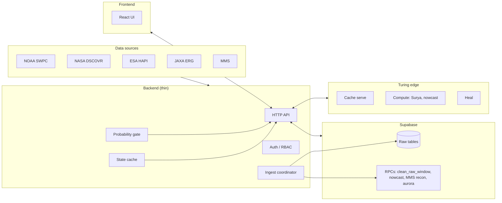

# Offload Architecture

This document describes an architecture where **bulk storage** and **heavy aggregation** live in Supabase, the **backend** stays thin (auth, ingest coordinator, bounded state), and **edge (Turing) devices** run only “AI model refinery” (e.g. Surya, nowcast) and device-local processing (cache, heal). No bulk ETL or long retention on edge.

## Roles

### Supabase (cloud / managed server)

- **Bulk storage:** Raw and derived tables (e.g. `sw_raw_samples`, `mms_raw_fgm`, `mms_raw_mec`, `source_health`, and any clean/aggregate tables).
- **RPCs for cleanup and derived products:**
  - `clean_raw_window` — drops or archives raw rows outside a time window (invoked by ingest-loop and full-stack mission).
  - `generate_nowcast_5s` — builds nowcast series.
  - `compute_mms_recon_vectors_5s` — MMS reconnection vectors.
  - `build_aurora_healpix_map` — aurora HEALPix map.
- Heavy aggregation and retention stay here; the backend triggers RPCs and reads results but does not hold bulk data.

### Backend (single node, e.g. 8GB M1)

- **Thin API:** Auth, session, feed endpoints, ops, ingest coordinator.
- **State cache:** Bounded in-memory feeds (canonical 20k, MMS 5k, decoder 1k, feedback 500, Cybertiger events, Turing devices). See [DATA_ANALYSIS_MODELS.md](DATA_ANALYSIS_MODELS.md).
- **Probability gate:** Lightweight pre-inference gating (e.g. 3-sigma) so the heavy LLM stays dormant unless needed.
- **Optional:** Light nowcast proxy or proxy to Turing for Surya/nowcast; no bulk ETL or long retention.

### Edge (Turing devices)

- **AI model refinery only:** Surya, nowcast, or other inference jobs dispatched from the backend. Devices run Python + model and return results.
- **Device-local:** In-memory cache (serve/expire), health/heal. No bulk ETL or long retention on edge.

## Diagram



## Compute and power projection

Estimates below should be validated with real deployment. They are used for capacity planning and documentation only.

| Component | vCPU | RAM | GPU | Power (order of magnitude) | Notes |
|-----------|------|-----|-----|-----------------------------|--------|
| **Supabase** | Managed | Managed | — | N/A | Expected load: rows/day for raw tables (from ingest cadence); RPC invocations per 5 min (e.g. clean_raw_window, generate_nowcast_5s at ingest tick). No explicit vCPU/W for managed DB. |
| **Backend node (e.g. M1 8GB)** | 1 node | 4–8 GB | None | ~10–15 W idle, ~20–25 W under load | Public M1 specs; single process, bounded state. |
| **Turing edge (per device)** | 1–4 vCPU | 2–8 GB | Optional | ~5–15 W per device | Cache-only: ~1 vCPU, 2 GB. Surya/nowcast: 4 vCPU, 8 GB + optional GPU (Raspberry Pi / NUC class). |

**Total (example):** 1 backend + N Turing nodes → backend ~20 W + N × ~10 W. **Recommended max concurrent Surya jobs per 8GB device: 1.**

---

## Optional: compute-power report script

Run `backend/scripts/compute-power-report.ts` to output a short report (markdown or JSON) with the same categories (Supabase, backend, edge) and projected compute (vCPU, RAM) and power (W).

```bash
npx tsx backend/scripts/compute-power-report.ts
npx tsx backend/scripts/compute-power-report.ts --json
```

Env (optional): `COMPUTE_REPORT_TURING_DEVICES` (number of Turing devices), `COMPUTE_REPORT_OUTPUT=json`.
