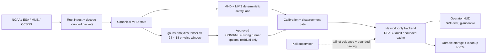

# Project Gauss — system-of-systems one-pager

## Mission

Gauss is an offline-first space-operations platform that keeps the safety path
deterministic and bounded while allowing approved learned analysis to run on a
network edge. The operator always receives freshness, confidence, provenance,
and blocker evidence with the result.

## Compute placement

| Lane | Placement | Role | Authority |
| --- | --- | --- | --- |
| Packet decode and validation | Rust/orchestrator | CCSDS/XTCE decode, bounds, quality | Safety input |
| MHD/MMS physics | Backend/Rust-compatible deterministic code | Causal state and vector fusion | Primary operational truth |
| Tensor packing | Rust + TypeScript contract | Fixed shapes, normalization, masks, provenance | Interoperability boundary |
| Learned inference | Optional Turing/network worker | Forecast residuals and uncertainty | Never overrides safety lane |
| Storage and retention | Supabase/RPCs | Durable raw/derived products and cleanup | Bounded history |
| Operator interface | React/SVG | Glanceable state and evidence | Human decision support |

## Resource posture

- Fixed tensor dimensions prevent unbounded model input growth.
- Empty or stale lanes are represented by masks, not fabricated values.
- The no-runner path performs no network call and returns deterministic output.
- Calibration drops learned weight to zero when reliability is low or disagreement
  is high.
- The Kali supervisor can only restart allow-listed user services and shed
  optional work under pressure.

## Readiness language

Use `observed`, `verified`, `unknown`, or `blocked` in presentations. Do not call
the remote backend production-ready until its secret-backed environment,
allow-listed services, compute-sharing audit, and logout-persistence evidence
are all present.
